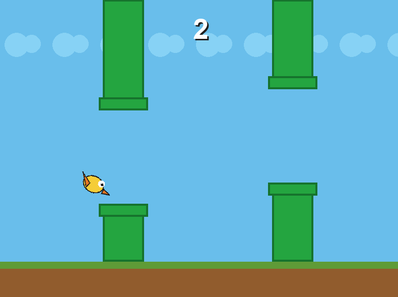
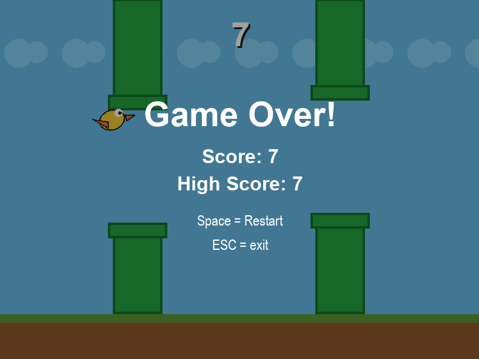

<div align="center">

# Flappy Bird

### A simple, colorful Flappy Bird game made with Python and Pygame.


</div>

---

## Screenshots


<div align="center">



*Gameplay screenshot*



*Game Over screen*

</div>

---

## Features

- 🐤 Custom-drawn animated bird
- 🟢 Randomly generated pipes
- 🎯 Score tracking
- 🏆 Persistent high score saved in `highscore.json`
- ⏱️ 0.7-second restart cooldown
- 🌤️ Colorful background and scenery
- 🎮 Simple keyboard controls
- ⚡ Lightweight and optimized gameplay

## Controls

| Key | Action |
|---|---|
| `SPACE` | Start / Fly / Restart |
| `ESC` | Quit the game |

## Requirements

- Python 3.11–3.13 recommended
- Pygame 2.6.1 or newer

## Installation

**1. Clone the repository**

```bash
git clone https://github.com/YOUR_USERNAME/flappy-bird.git
```

**2. Enter the project directory**

```bash
cd flappy-bird
```

**3. Install dependencies**

```bash
py -m pip install -r requirements.txt
```

**4. Run the game**

```bash
py flappy-bird.py
```

## Project Structure

```text
flappy-bird/
│
├── flappy-bird.py
├── requirements.txt
├── highscore.json
├── README.md
│
└── screenshots/
    ├── gameplay.png
    └── game-over.png
```

`highscore.json` is automatically created when a new high score is achieved.

## High Score System

Your best score is automatically saved locally.

Example `highscore.json`:

```json
{
    "highscore": 15
}
```

Your record remains saved even after closing the game.

## Built With

- [Python](https://www.python.org/) – Programming language
- [Pygame](https://www.pygame.org/) – Game development library

## Author

**David_Lachtan**

Made with Python and Pygame.

---

<div align="center">

### Enjoy the game!

**If you like this project, consider giving it a star on GitHub.**

</div>
